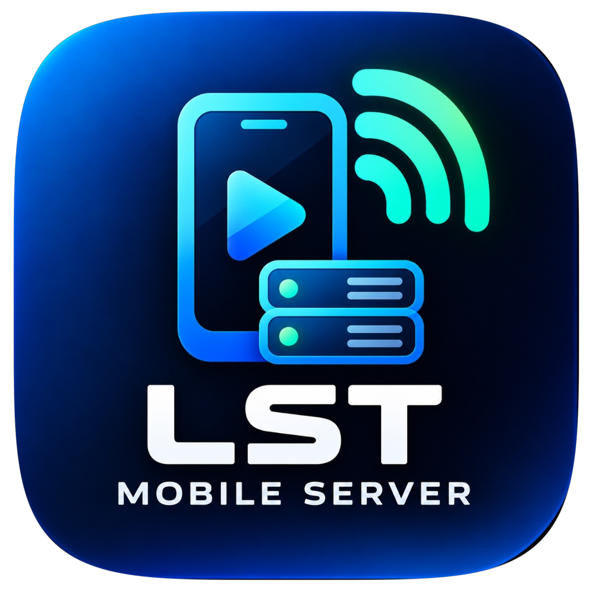

<p align="center">
  
</p>

<p align="center">
  
</p>

<h1 align="center">LST Mobile Server</h1>

<p align="center">
  <a href="https://android.com"></a>
  <a href="https://kotlinlang.org"></a>
  <a href="https://ktor.io"></a>
  <a href="LICENSE"></a>
  
</p>

<p align="center">
  <strong>Transform your Android device into a high-speed local media &amp; file streaming server.</strong><br />
  Stream movies, music, and files directly to Smart TVs, PCs, and phones with zero internet or cloud accounts required.
</p>

---

## 🚀 Key Features

### 🖥️ 1. Embedded HTTP Server Engine
* **Ktor CIO Backend**: High-concurrency, asynchronous, non-blocking HTTP engine optimized for low memory usage and high-throughput file streaming on mobile hardware.
* **HTTP Byte-Range Streaming (`206 Partial Content`)**: Supports seamless seeking in video and audio files without loading entire files into memory.
* **Persistent Foreground Service**: Runs reliably in the background with ongoing notifications, WakeLock, and battery optimization support so transfers stay uninterrupted when the screen turns off.
* **Customizable Binding**: Configurable server port (1024–65535) and mDNS hostname, with automatic local IP detection (Wi-Fi & SoftAP Hotspot).

### 🔍 2. Zero-Config Discovery & Networking
* **Dual Discovery Engine**: 
  * Native Android NSD (Network Service Discovery / mDNS `_http._tcp.`) for cross-device discovery.
  * Custom UDP 5353 SoftAP responder for reliable discovery on Android Wi-Fi Hotspots where multicast is frequently restricted.
* **Instant QR Code & URL Sharing**: Displays live connection URLs and generates on-device QR codes for instant connection by phone cameras or TV scanners.
* **1-Tap Disconnected View**: If disconnected, Explorer presents a clean "Connect to a Server" button or 1-tap "Start Local Server" instead of raw error codes.

### 📁 3. Local & Remote File Explorer
* **Secure Storage Access Framework (SAF)**: Uses Android's native directory picker with persistable permissions (`takePersistableUriPermission`). No hazardous root or `MANAGE_EXTERNAL_STORAGE` permissions required.
* **Virtual Root & Subdirectories**: Clean virtual breadcrumb navigation (`🏠 Root (Shares) > Folder > Subfolder`) with instant search and folder filtering.
* **Multi-Server Switching**: Seamlessly switch between the local server and any discovered servers on your network.

### 🎬 4. Media Playback & External Player Integration
* **Inbuilt Music Player**: Built-in audio player with track scrubbing, duration tracking, background playback, and handoff to external players.
* **External App Integration for Other Formats**: Videos, photos, PDFs, APKs, documents, and archives automatically open in your preferred installed apps (e.g., VLC, MX Player, Google Photos, Acrobat Reader) via standard Android `ACTION_VIEW` intents.
* **Configurable Audio Default**: A dedicated switch in **Settings > Media & Playback Preferences** allows setting external media players (e.g., VLC, Poweramp) as default for music and audio as well.

### 📥 5. High-Speed Download Manager
* **Concurrent Chunked Downloads**: Multi-connection downloader supporting Pause, Resume, Cancel, and Retry.
* **Real-Time Speed & ETA**: Live throughput metrics (KB/s, MB/s), progress percentages, and estimated time remaining.
* **Scoped Storage Safe**: Saves downloads cleanly to public storage or custom directories with instant `FileProvider` launch on completion.

### 🌐 6. Responsive Built-in Web Client
* **Zero-Install Web App**: Served directly by the device at `http://<phone-ip>:<port>/`.
* **Cross-Device Ready**: Designed with a sleek dark-mode UI for phones, tablets, laptops, and TV browsers.
* **Media Sections**: Dedicated tabs for **Browse**, **Videos**, **Music**, and **Photos** with interactive playback and thumbnail galleries.


---

## 🛠️ Architecture & Technology Stack

| Layer | Technology |
|---|---|
| **Language & Platform** | Kotlin 1.9, Java 17, Android SDK 24–34 |
| **HTTP Server** | [Ktor CIO](https://ktor.io/) embedded asynchronous server |
| **Discovery** | Android `NsdManager` + Custom `MdnsResponder` (UDP 5353) |
| **Service & Lifecycle** | Android `ForegroundService` with `specialUse` type and Kotlin Coroutines / StateFlow |
| **Storage & Security** | Android Storage Access Framework (`DocumentFile`), SAF URI persistence |
| **UI Components** | Android Jetpack, Material Design 3, ViewBinding, Navigation |
| **Web Client** | Modern responsive HTML5, CSS3, Vanilla JS, single-file bundle in assets |

---

## 📂 Project Structure

```
Mobile app/
├── app/
│   ├── src/
│   │   ├── main/
│   │   │   ├── AndroidManifest.xml        # Foreground service, permissions, file provider
│   │   │   ├── assets/web/index.html      # Bundled web client served to browsers
│   │   │   ├── java/com/localserver/
│   │   │   │   ├── MainActivity.kt        # Main tab navigation (Explorer, Discover, Settings)
│   │   │   │   ├── ExplorerFragment.kt    # File explorer, breadcrumbs, download manager UI
│   │   │   │   ├── DiscoverFragment.kt    # Network server scanner & NSD viewer
│   │   │   │   ├── SettingsFragment.kt    # Port config, shares, external audio switch
│   │   │   │   ├── ClientViewerActivity.kt# In-app WebView viewer for testing web client
│   │   │   │   └── core/
│   │   │   │       ├── ServerService.kt       # Foreground service running Ktor
│   │   │   │       ├── RequestRouter.kt       # API endpoints & static asset routes
│   │   │   │       ├── StreamingHandler.kt    # HTTP 206 Partial Content byte-range handler
│   │   │   │       ├── ShareRegistry.kt       # SAF shares database & URI permission keeper
│   │   │   │       ├── FileRepository.kt      # Directory listing, recursive lookup & MIME resolution
│   │   │   │       ├── NsdDiscoveryManager.kt # mDNS discovery engine
│   │   │   │       ├── MdnsResponder.kt       # SoftAP UDP 5353 multicast responder
│   │   │   │       ├── DownloadManager.kt     # Background download task pipeline & StateFlow
│   │   │   │       └── ServerConfig.kt        # Port, server name, and playback preferences
│   │   │   └── res/
│   │   │       ├── drawable/              # Custom vector icons and badge shapes
│   │   │       ├── layout/                # Material UI layouts & dialogs
│   │   │       └── values/                # Strings, dark navy color palette, themes
│   │   └── test/                          # Comprehensive JUnit unit test suite (51 tests)
├── build.gradle.kts                       # Root Gradle build configuration
├── settings.gradle.kts                    # Project modules & dependency repositories
└── README.md                              # This documentation
```

---

## 📡 HTTP API Endpoints

The embedded server exposes a clean RESTful and streaming interface for web browsers, Android TV clients, and media players:

| Method | Endpoint | Description |
|---|---|---|
| `GET` | `/` or `/index.html` | Serves the responsive browser web client |
| `GET` | `/api/status` | Returns server health, name, port, and connected clients count |
| `GET` | `/api/shares` | Returns JSON array of authorized root folders (`id`, `name`, `isAccessible`) |
| `GET` | `/api/browse?shareId={id}&path={subpath}` | Lists contents of a directory (files, folders, sizes, MIME types) |
| `GET` | `/api/stream?shareId={id}&path={path}` | **Byte-range media streaming** with `206 Partial Content` support |
| `GET` | `/api/shares/{id}/files/{fileId}/download`| Direct download attachment with `Content-Disposition` |

---

## 🔒 Security & Privacy

1. **Intranet Only**: All data transfer stays strictly within your Wi-Fi or Hotspot network. No cloud relays, external telemetry, or internet access required.
2. **Read-Only Guarantees**: Connected clients can only read, stream, and download. The server rejects write, upload, rename, and delete requests.
3. **Directory Boundary Enforcement**: Path traversal attacks (e.g. `../` or encoded variations) are blocked; clients cannot escape the shared folder boundaries.
4. **Scoped SAF Access**: The app accesses only the folders you explicitly pick through Android's system document picker.

---

## ⚙️ Building & Running

### Prerequisites
* **Java Development Kit (JDK)**: JDK 17 or higher
* **Android SDK**: API 34 platform & build tools installed
* **Gradle**: Gradle 8.4+ (Wrapper provided)

### Build Commands
```bash
# Clone or navigate to the project directory
cd "Local media sever/Mobile app"

# Run the unit test suite (51 tests)
./gradlew test

# Build debug APK
./gradlew assembleDebug

# Build release APK
./gradlew assembleRelease
```

The compiled APKs will be located at:
* **Release APK (Recommended for distribution)**: `app/build/outputs/apk/release/app-release.apk`
* **Debug APK (For development/testing)**: `app/build/outputs/apk/debug/app-debug.apk`

---

## 📱 How to Use

1. **Launch App**: Open **LST Mobile Server** on your Android device.
2. **Add Folders**: Go to **Settings > Shared Folders** and tap **+ Add Folder** to select directories you want to share.
3. **Start Server**: Tap **Start Server**. The notification will show the active port and IP address.
4. **Connect Other Devices**:
   * Open the displayed URL (e.g. `http://192.168.1.5:8080`) in any browser on your computer, TV, or phone.
   * Or scan the **QR Code** in Settings.
5. **Stream & Download**: Browse your folders, stream videos and music, or download files at full Wi-Fi speeds.

---

## 📄 License

This project is licensed under the Apache License 2.0. See the `LICENSE` file for details.
